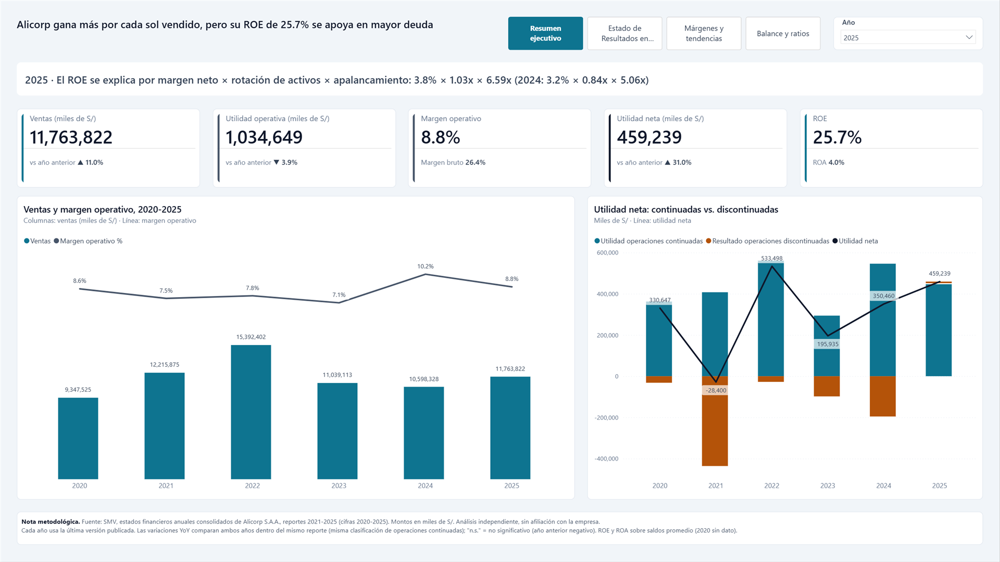
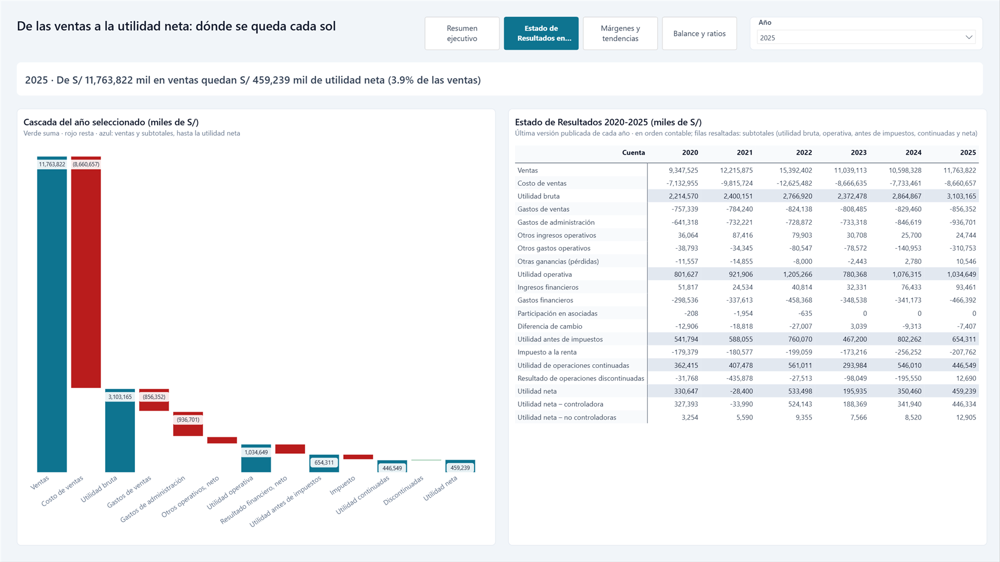
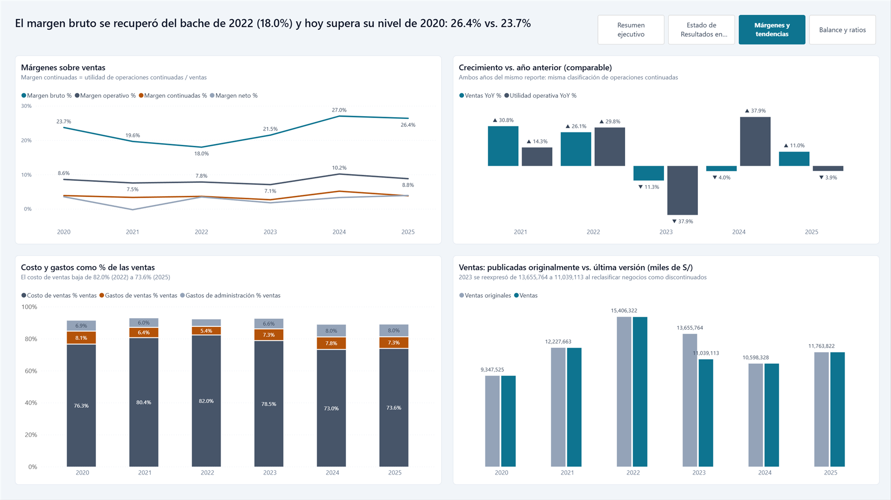
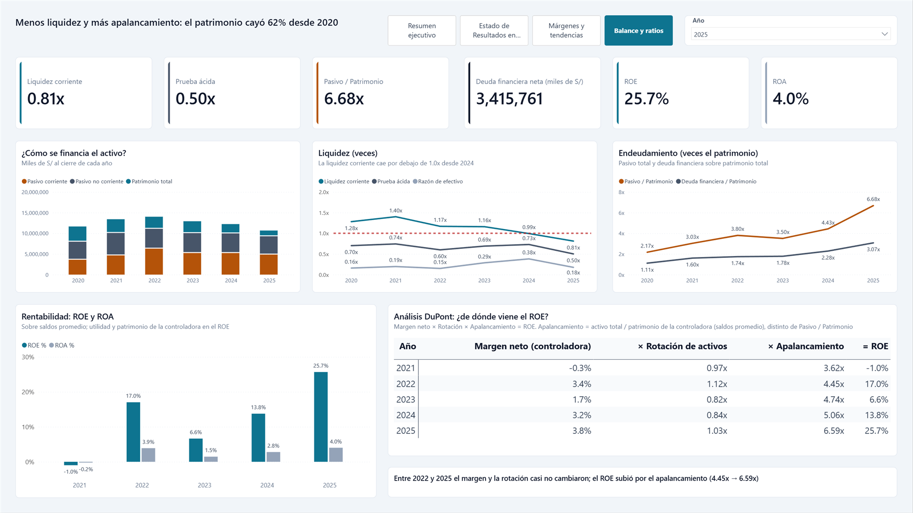

# Alicorp: rentabilidad y apalancamiento 2020-2025

**Alicorp gana más por cada sol vendido, pero su ROE de 25.7% en 2025 se apoya en mayor apalancamiento.**
El análisis DuPont lo muestra: entre 2022 y 2025 el margen neto (3.4% → 3.8%) y la rotación de activos (1.12x → 1.03x) casi no cambiaron, mientras que el apalancamiento pasó de 4.45x a 6.59x.

Dashboard financiero en Power BI construido de punta a punta con datos públicos de la Superintendencia del Mercado de Valores (SMV): estados financieros anuales consolidados de Alicorp S.A.A., reportes 2021-2025 (cifras 2020-2025), en miles de soles.

---

## El dashboard

**1. Resumen ejecutivo**: KPIs del año elegido con su variación, ventas vs. margen operativo y el peso de las operaciones discontinuadas.


**2. Estado de Resultados en cascada**: de las ventas a la utilidad neta, paso a paso y con subtotales, más el estado completo 2020-2025.


**3. Márgenes y tendencias**: márgenes, crecimiento en base comparable, estructura de costos y efecto de las reexpresiones.


**4. Balance y ratios**: liquidez, endeudamiento, ROE/ROA y la descomposición DuPont del ROE.


---

## Arquitectura

```
SMV (5 Excel)  →  Python  →  DuckDB  →  Parquet  →  Power BI (PBIP)
raw/*.xlsx        etl_smv.py      finanzas.duckdb    parquet/*.parquet    powerbi/Alicorp Finanzas.pbip
                  modelo_smv.py                                           (TMDL + PBIR)
                  exportar_parquet.py
```

| Capa | Qué hace |
|---|---|
| **Fuente** | 5 archivos Excel de la SMV (uno por año de reporte). Cada uno trae el año actual y el anterior de 4 estados: situación financiera, resultados, flujo de efectivo y resultados integrales. |
| **`etl_smv.py`** | Lee los Excel con `openpyxl`, normaliza (negativos como texto `"(1,234)"`, notas, espacios) y carga la tabla `fact_eeff` en formato largo: 2,360 filas, una por reporte × año × cuenta. Ejecuta las validaciones de origen. |
| **`modelo_smv.py`** | Construye el modelo analítico en DuckDB: versión vigente de cada cifra, dimensiones de cuentas desde los mapeos editables `mapeos/*.csv` y vistas `pbi_*` listas para Power BI, incluida la vista comparable para las variaciones año a año. |
| **`exportar_parquet.py`** | Exporta las 7 vistas `pbi_*` a `parquet/`. Los Parquet se versionan en el repo, así el dashboard abre sin correr Python. |
| **Power BI (PBIP)** | Modelo semántico en TMDL: 7 tablas, 9 relaciones y 65 medidas DAX con descripción. Reporte en PBIR: 4 páginas generadas por código con `powerbi/generar_reporte.mjs`. Todo es texto versionable en git. |

---

## Decisiones metodológicas

**1. Última versión publicada de cada año.** Cada año aparece en dos reportes: el suyo y el siguiente, como comparativo. Cuando difieren (reexpresiones), se usa el reporte más reciente. Hay 90 cifras reexpresadas; la mayor es la reclasificación de negocios a operaciones discontinuadas. Por ejemplo, las ventas 2023 pasaron de 13,655,764 a 11,039,113 miles de S/ en el reporte 2024. 2020 solo existe en el reporte 2021.

**2. Variación año a año en base comparable.** Con la regla anterior, el año Y sale del reporte Y+1 y el año Y−1 del reporte Y, que pueden clasificar distinto. Por eso las variaciones YoY toman **ambos años del mismo reporte**:

| Ventas 2023 vs. 2022 | Cálculo | Variación |
|---|---|---|
| Mezclando versiones (incorrecto) | 11,039,113 vs. 15,392,402 | **−28.3%** |
| Base comparable (reporte 2023) | 13,655,764 vs. 15,392,402 | **−11.3%** |

La diferencia no es caída de ventas: es el perímetro que se reclasificó como discontinuado.

**3. "n.s." (no significativo).** Si el año anterior tiene el signo contrario a la naturaleza de la cuenta (por ejemplo, una utilidad que fue pérdida), el porcentaje no tiene interpretación y se muestra "n.s.". Caso real: la utilidad neta 2022 frente a la pérdida de 2021 daría +1,978%.

**4. ROE con la controladora y saldos promedio.** ROE = utilidad neta atribuible a la controladora ÷ patrimonio de la controladora promedio (inicio y fin de año). ROA = utilidad neta ÷ activo total promedio. 2020 queda sin dato porque no hay saldo inicial.

**5. DuPont coherente con el ROE.** ROE = margen neto (controladora) × rotación de activos × apalancamiento, con las mismas definiciones y saldos promedio. El apalancamiento es activo total ÷ patrimonio de la controladora, no Pasivo ÷ Patrimonio. Así el producto de los tres factores reproduce exactamente el ROE y se puede ver de dónde viene.

**6. Sin EBITDA.** El reporte estructurado de la SMV no incluye depreciación ni amortización en ningún estado: el estado de resultados presenta los gastos por función y el flujo de efectivo usa el método directo, sin conciliación. Calcular un EBITDA exigiría tomar cifras de las notas en PDF, fuera del alcance de una fuente reproducible. En su lugar se usan la utilidad y el margen operativos.

---

## Validaciones

Cada script termina con error si falla una validación. Todas pasan:

| Validación | Resultado |
|---|---|
| **Cuadre del balance**: activo total = pasivo + patrimonio, en cada reporte y año | Cuadra en los 10 pares reporte-año. El balance no tiene reexpresiones. |
| **Control de origen**: ingresos, utilidad bruta y operativa 2021 contra el reporte original | Coincide (ingresos 2021 = 12,227,663) |
| **Integridad**: plantilla idéntica en los 5 reportes, sin montos sin interpretar, mapeo completo de cuentas | OK |
| **Subtotales**: cada subtotal del estado de resultados = suma acumulada del detalle; la cascada termina en la utilidad neta; el detalle del balance suma el total de cada grupo | OK |
| **DAX = SQL**: 40 medidas × 6 años = **240 valores** calculados en Power BI vs. un cálculo SQL independiente sobre `fact_eeff` | 240 de 240 idénticos |
| **DuPont = ROE**: margen × rotación × apalancamiento vs. `ROE %`, 2021-2025, en DAX y en SQL | Diferencia máxima 3 × 10⁻¹⁷ (redondeo de coma flotante) |

---

## Cómo reproducirlo

Requisitos: Windows, Python 3 (probado con 3.14) y Power BI Desktop (con el formato PBIP habilitado). Node.js solo si se quiere regenerar el reporte.

```powershell
# 1. Entorno virtual dentro del proyecto
python -m venv .venv
.venv\Scripts\python.exe -m pip install -r requirements.txt   # duckdb 1.5.6, openpyxl 3.1.5

# 2. Pipeline, en este orden (cada script es idempotente)
.venv\Scripts\python.exe etl_smv.py           # raw/*.xlsx → finanzas.duckdb (fact_eeff) + validaciones
.venv\Scripts\python.exe modelo_smv.py        # dimensiones, versión vigente y vistas pbi_*
.venv\Scripts\python.exe exportar_parquet.py  # vistas pbi_* → parquet/*.parquet
```

3. **Apuntar Power BI a la carpeta de los Parquet.** El modelo usa el parámetro de Power Query `CarpetaParquet`, que por defecto es `E:\Proyectos\finanzas-smv\parquet\`. Si clonaste el repo en otra ruta, cámbialo en Power BI Desktop (*Inicio → Transformar datos → Editar parámetros*). Debe terminar en `\`.
4. **Abrir `powerbi/Alicorp Finanzas.pbip`** y pulsar *Actualizar*.
5. **Cerrar sin guardar.** Las páginas del reporte se generan con `node powerbi/generar_reporte.mjs`. Al abrir un PBIP generado, Desktop marca cambios pendientes, y si guardas reescribe los archivos en su propio formato. Para cambiar el diseño, edita el generador y vuelve a ejecutarlo.

Notas:
- DuckDB bloquea `finanzas.duckdb`: cierra cualquier cliente (por ejemplo, DBeaver) antes de correr los scripts.
- `finanzas.duckdb` y `.venv/` no se versionan porque se regeneran con los pasos anteriores.

### Estructura del repositorio

```
raw/                     Excel originales de la SMV (2021-2025)
etl_smv.py               ETL + validaciones de origen
modelo_smv.py            Modelo analítico en DuckDB + validaciones
mapeos/                  Mapeos editables de cuentas (estado de resultados, balance, empresa)
exportar_parquet.py      Exportación a Parquet
parquet/                 Datos que consume Power BI
powerbi/                 Proyecto PBIP (modelo TMDL + reporte PBIR) y generador del reporte
_brief/report-spec.md    Especificación de diseño del reporte
docs/img/                Capturas
CLAUDE.md                Memoria del proyecto: objetivo, etapas, decisiones y estado
```

---

## Cómo se trabajó con Claude Code

El proyecto se construyó con **Claude Code**, el agente de programación de Anthropic, siguiendo un flujo por etapas con aprobación explícita:

1. **ETL** → 2. **Modelo analítico (DuckDB)** → 3. **Modelo semántico (Power BI)** → 4. **Reporte**.

En cada etapa el agente presentaba un plan, construía y mostraba los resultados de las validaciones. Se detenía hasta recibir la aprobación y solo entonces pasaba a la siguiente. El archivo `CLAUDE.md` funcionó como memoria del proyecto: objetivo, estructura de la fuente, decisiones tomadas, hallazgos y estado, actualizado al cierre de cada etapa. Así cualquier sesión nueva retomaba con el contexto completo.

**Qué decidí o aprobé yo**

Varias decisiones metodológicas (la versión vigente, la base comparable para el YoY, la entrega en Parquet) fueron propuestas por el agente. Mi trabajo fue entender cada una, cuestionarla y aprobarla o corregirla. Además usé Claude como revisor externo del diseño, la narrativa y las cifras antes de dar por buena cada etapa.

- El alcance, el orden de las etapas y la regla de no avanzar sin aprobación.
- Las reglas de negocio, aprobadas tras revisar las alternativas:
  - usar la última versión publicada de cada año;
  - calcular las variaciones YoY en base comparable;
  - expresar los montos en miles de S/;
  - mantener el ROA;
  - mostrar "n.s." cuando el año anterior es negativo.
- Agregar el análisis DuPont con las mismas definiciones que el ROE.
- La arquitectura de entrega: Parquet versionado en el repo, parámetro de carpeta en Power Query y entorno virtual dentro del proyecto.
- La audiencia (portafolio público) y el estilo visual (corporativo sobrio).
- La narrativa: los títulos de cada página y la tesis.
- Las correcciones tras revisar cada versión. Por ejemplo, que el Estado de Resultados se vea como lista plana en orden contable, con los subtotales resaltados.
- Los commits.

**Qué hizo el agente**
- Explorar la estructura de los Excel de la SMV. Detectó que la plantilla es idéntica entre años y que hay nombres de cuenta repetidos, por lo que la clave estable es la posición.
- Escribir el ETL, el modelo en DuckDB, los mapeos de cuentas y la exportación.
- Detectar las reexpresiones y el problema de comparabilidad YoY, y proponer la vista comparable.
- Construir el modelo semántico con el MCP de modelado de Power BI y escribir las medidas DAX.
- Escribir el generador del reporte, revisar capturas de Desktop y corregir problemas visuales.
- Diseñar y ejecutar las validaciones, incluida la comparación DAX vs. SQL independiente.

Cada cifra que muestra el dashboard se verificó contra un cálculo independiente antes de darla por buena.

---

## Limitaciones

- Una sola empresa y frecuencia anual: no hay comparación con pares del sector ni datos trimestrales.
- Las cifras son las publicadas en la SMV. Si un reporte futuro reexpresa años anteriores, la historia cambiará al volver a correr el pipeline.
- Sin EBITDA ni flujo de caja libre (ver *Decisiones metodológicas*).
- La matriz del Estado de Resultados resalta los subtotales solo en las celdas de valores: Power BI no admite formato condicional en los encabezados de fila.
- En la cascada, las barras muy delgadas (por ejemplo, impuesto o discontinuadas) no muestran su cifra porque no cabe. El valor está en la matriz contigua y en el tooltip.
- El formato PBIP requiere Power BI Desktop en Windows.

## Nota de independencia

Análisis independiente con fines de portafolio, basado exclusivamente en información pública de la SMV. **No tiene afiliación con Alicorp S.A.A.** ni representa su posición, y no constituye una recomendación de inversión. Los nombres de la empresa se usan solo para identificar la fuente de los datos.

---

## Otros proyectos

- [etl-bcrp-airflow](https://github.com/AndreRHz/etl-bcrp-airflow): pipeline ETL de series del BCRP con Apache Airflow, Docker y DuckDB.
- [bcrp-dashboard-ai-agent](https://github.com/AndreRHz/bcrp-dashboard-ai-agent): rediseño de un dashboard de Power BI con agentes de IA en formato PBIP.

---

**Autor:** Christian Andre Rodriguez Angeles · Analista de Datos
[LinkedIn](https://www.linkedin.com/in/christian03rodriguez/) · [GitHub](https://github.com/AndreRHz)
